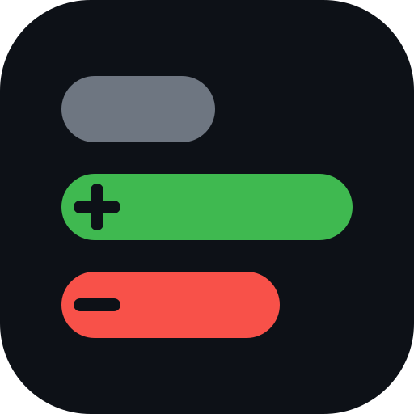
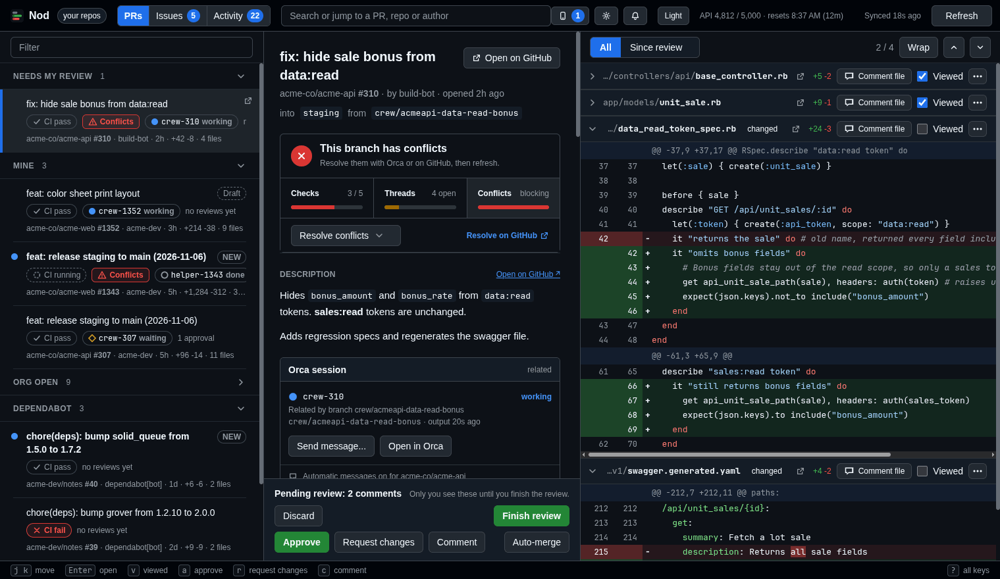
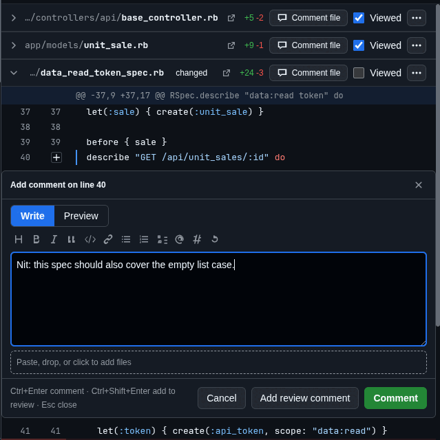
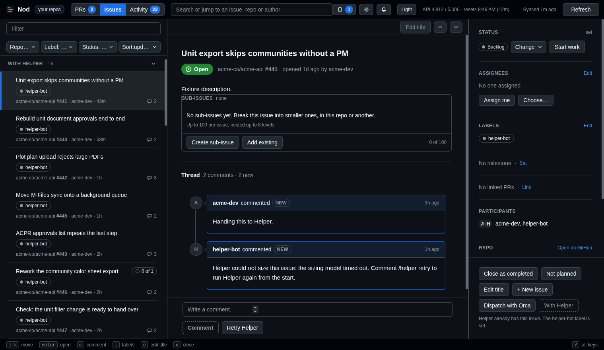
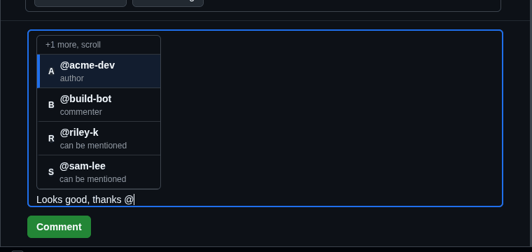
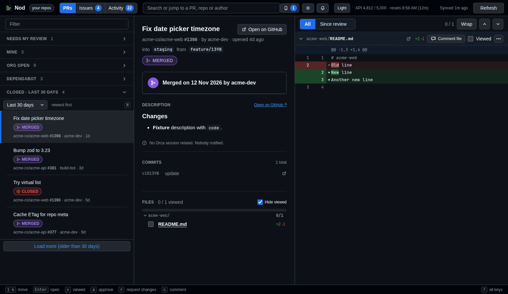
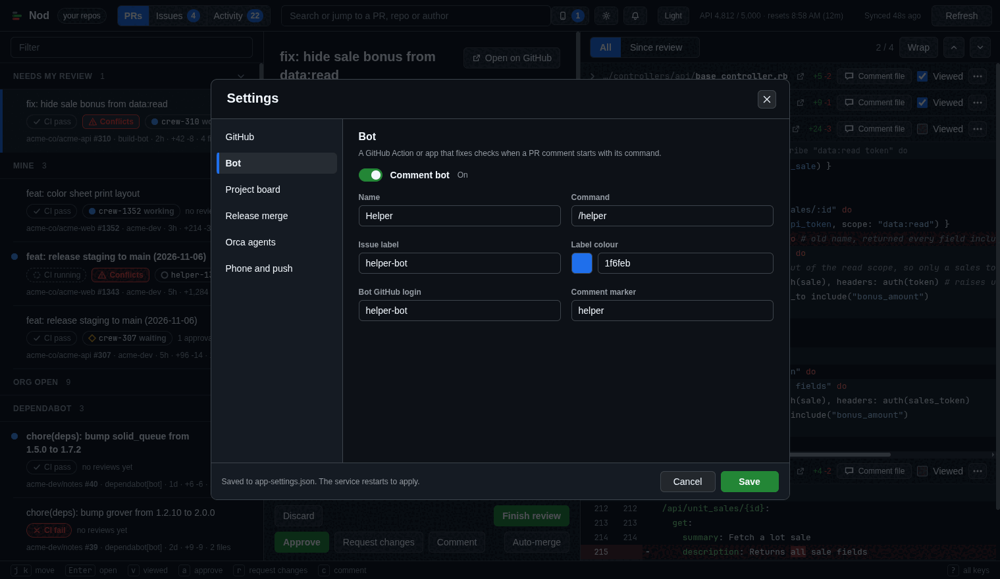
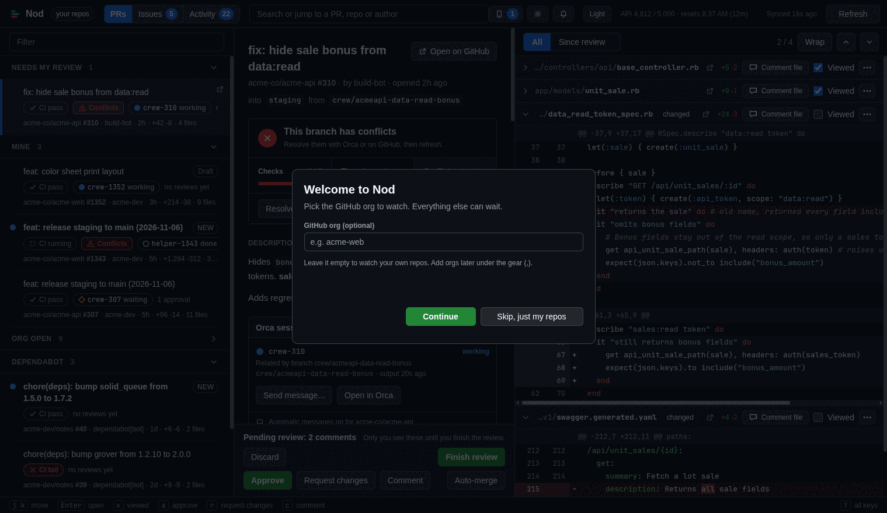

<p align="center">
  
</p>

<h1 align="center">Nod</h1>

<p align="center">A local pull request and issue queue for GitHub.</p>

<p align="center">
  <a href="LICENSE"></a>
  <a href="tsconfig.json"></a>
  <a href="pnpm-workspace.yaml"></a>
</p>

<p align="center">
  
</p>

## Why

- One list of the PRs that need your review, your own, your org's open ones and Dependabot's.
- Issues grouped by who is on them, with inline review comments and a phone view.
- It runs on your machine and uses your own GitHub token.

## Features

- **Review queue.** PRs that need your review, your own, your org's and Dependabot's, with a checks rollup and a "since my review" diff.
- **Inline comments.** Comment on a line, a range or a file. Keep drafts in a pending review, reply to threads and resolve them.
- **Issues.** Groups by who is on them, including a `With <bot>` group for the issues a bot is working on, plus a Check with the bot action.
- **Mentions.** Suggestions as you type `@` in a comment.
- **Closed items.** Look back at closed PRs and issues.
- **Phone.** The same queue on your phone over Tailscale. See [docs/phone.md](docs/phone.md).
- **Settings.** Change the app's options from inside the app.

<p align="center">
  
</p>

<p align="center">
  
</p>

<p align="center">
  
</p>

<p align="center">
  
</p>

<p align="center">
  
</p>

## Quick start

You need Node, pnpm, and a GitHub login (`gh auth login`).

```
pnpm install
pnpm start
```

Open the URL that `pnpm start` prints (default `http://127.0.0.1:4477`). Set `PORT` to change the port.

To try the app without GitHub calls, run `NOD_FIXTURES=1 pnpm start` or `pnpm start --fixtures`. It serves synthetic data.

The first time Nod starts it asks which GitHub org to watch. You can skip that and see only your own repos.

<p align="center">
  
</p>

## Desktop app

```
pnpm app:dist
scripts/install-desktop.sh
nod
```

See [docs/desktop.md](docs/desktop.md) for updates, autostart and uninstall.

## Settings

Org-specific values live in `app-settings.json`. Every key is optional, and a missing file means the defaults.

See [docs/settings.md](docs/settings.md) for the keys and the file location.

## More

- [Keys](docs/keys.md): keyboard shortcuts.
- [Phone](docs/phone.md): phone access, pairing, updates and the service.
- [Android](docs/android.md): the Android app.
- [Orca](docs/orca.md): Orca agent sessions.
- [Security](docs/security.md): tokens, binding and request guards.
- [API comments](docs/api-comments.md): the comments API.
- [Notifications](docs/notifications.md): desktop and phone notifications.
- [Desktop](docs/desktop.md): the desktop app.
- [Issues](docs/issues.md): the Issues view.
- [Behaviour](docs/behaviour.md): polling, caching and rate limits.
- [Development](docs/development.md): fixtures, scripts and contributing.

## Security

- The GitHub token stays in server memory and never reaches the browser, logs or disk.
- The server binds to loopback by default.
- Host and Origin guards reject requests from other hosts and origins.

See [docs/security.md](docs/security.md) for the rest.

## Contributing

Run `pnpm typecheck && pnpm test` before you open a pull request. `scripts/oss-gate.sh` runs the release gate. For a large change, open an issue first.

## License

MIT. Copyright Deetss Labs. See [LICENSE](LICENSE).
