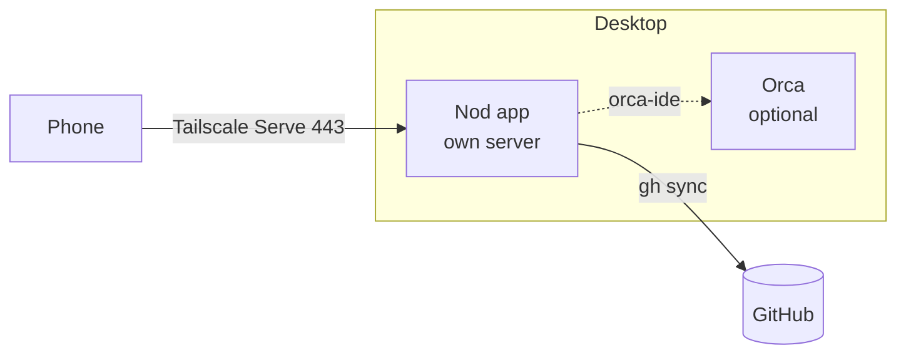
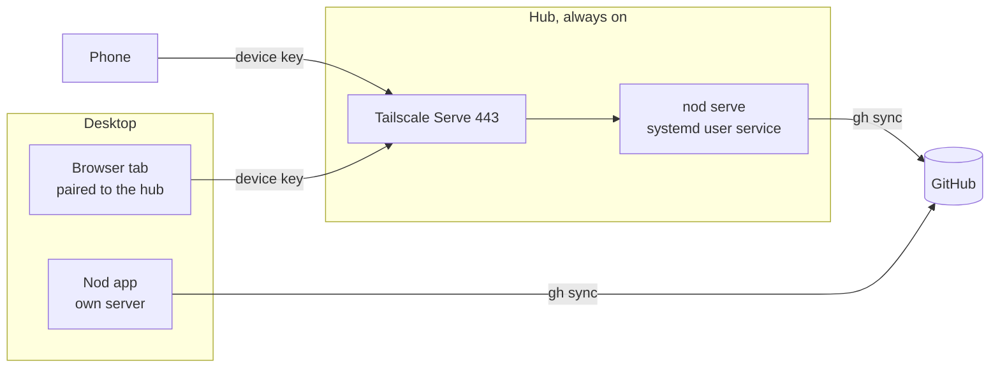
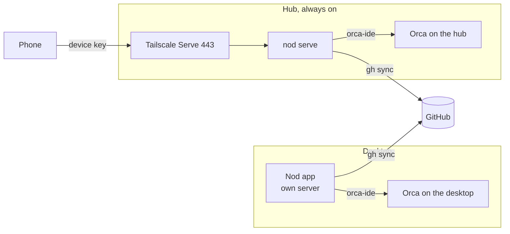

# Hub and spokes

A hub is one always-on Linux machine that runs Nod as a service. Your phone pairs to the hub, so it keeps working while your desktop is off or asleep. Desktops are spokes: each one still runs the Nod app, and any of them can also open the hub in a browser.

## Pick a setup

| Setup | Phone works when the desktop is off | Machines |
|---|---|---|
| Solo | No | One desktop |
| Hub | Yes | One always-on box, plus any desktops |
| Hub with Orca | Yes, and the phone can dispatch agents | Hub runs Orca too |

### Solo

The desktop app runs its own server. A phone pairs to the desktop and loses Nod when it sleeps.

### Hub

The hub syncs with GitHub, keeps the inbox state and sends Web Push. The phone and any paired browser reach it over Tailscale Serve, each with its own device key. A desktop app on a spoke keeps its own server, its own seen marks and its own settings.

### Hub with Orca

Orca actions run on the machine whose Nod server makes the call. Install Orca on the hub to see session chips and dispatch agents from the phone. Orca on a desktop serves only that desktop's app.

| Orca installed on | Phone sees sessions and dispatches | Desktop app sees sessions and dispatches |
|---|---|---|
| Hub only | Yes, on the hub | No |
| Desktop only | No | Yes, on the desktop |
| Both | Hub sessions | Desktop sessions |
| Neither | No Orca features | No Orca features |

## Set up the hub

Run these on the hub, from a checkout of this repo.

1. Log in to GitHub with the scopes Nod uses: `gh auth login -h github.com -s repo,read:org,project`.
2. Check the machine: `scripts/setup-hub.sh --check`. It checks the `gh` login and scopes, Tailscale, FUSE 2 and systemd linger, and prints a command for anything missing. It never runs `sudo`.
3. Copy your desktop settings, so the hub watches the same orgs: `scripts/setup-hub.sh --settings <path to app-settings.json>`. The desktop keeps them in `~/.config/nod/app-settings.json`. Skip `--settings` to keep the hub's own.
4. Without `--check`, the script downloads the latest release, installs the service, adds a headless drop-in when the box has no display, starts the service, and serves it on port 443 with Tailscale Serve. It stops rather than replace another site already on 443.
5. It prints the hub URL. `scripts/setup-hub.sh --pair` prints a one-time pairing link, good for 10 minutes.

Rerunning the script is safe. The service updates itself from releases after that.

## Move a phone to the hub

1. Run `scripts/setup-hub.sh --pair` on the hub.
2. Open the link on the phone, or enter the hub address in the app's setup screen and paste the code.

## Turn a desktop into a spoke

A desktop that used to host the phone should stop, so only the hub answers on the tailnet.

1. `systemctl --user disable --now nod`
2. `tailscale serve --https=443 off`, and the same for `8443` if you served it.
3. Quit the app (`Ctrl+Q`) and open it again. It starts its own server.
4. To use the hub from this desktop as well, open a pairing link from `scripts/setup-hub.sh --pair` in its browser.

## Not yet

- The desktop app cannot attach to a hub on another machine. It attaches only to a service on the same machine.
- Seen marks and settings on a spoke stay separate from the hub's.
- The hub cannot run Orca actions on another machine.
